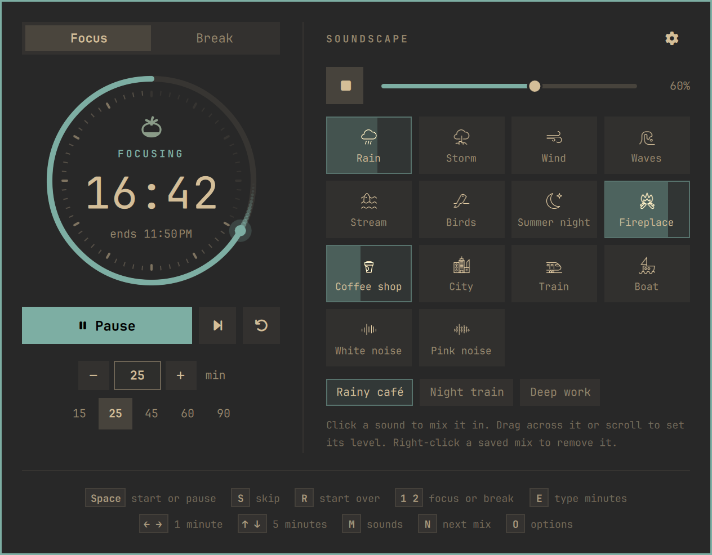

# Ripe 🍅

**A tomato in your [Omarchy](https://omarchy.org) bar that ripens while you focus.**

Click it and a popup opens right under the bar: set a session, mix yourself a
soundscape of rain and crackling fire, and press Start. Then get lost in the
work. When the time is up, Ripe makes sure you notice: the whole screen dims,
your desktop still visible beneath, and a single quiet message tells you to
step away.


## What it does

- **Focus and break, your way.** Any length from 1 minute to 3 hours. Type it,
  tap a preset, or scroll over the number. Change it mid-session and the
  running clock moves with you.
- **A time's-up moment you can't miss.** No toast in the corner: a full-screen
  message over your shaded desktop, with the next step one key away. Start the
  break, take five more minutes, or skip it.
- **A soundscape, built in.** Fourteen ambient sounds from
  [Blanket](https://github.com/rafaelmardojai/blanket): rain, storm, waves,
  fireplace, a coffee shop, a night train, and more. Click to layer them,
  drag across a tile to set its level. The mix fades in when you start
  focusing and stops when you stop.
- **A tomato that empties.** On the bar, Ripe drains as the session runs, with
  the countdown beside it. Right-click to start or pause, middle-click to skip.
- **Looks like it belongs.** Follows your Omarchy theme's colours, font, and
  corners, and every animation respects reduced motion.
- **Keyboard first, scriptable everywhere.** Every action has a key in the
  popup and a command for your bindings.
- **Private.** No network requests, no tracking, no history.



## Install

```bash
omarchy plugin add https://github.com/menelaostX99/ripe.git --enable
```

For the soundscape, install Blanket too:

```bash
omarchy pkg add blanket
```

Blanket only has to be installed, never running. Ripe reads the sounds from
Blanket's own files, unpacks them into `~/.cache/ripe`, and plays them itself.
The Flatpak build of Blanket works as well. Without Blanket, the timer works
and the mixer tells you what's missing.

### Blur behind the time's-up screen (optional)

The time's-up screen shades your desktop on its own. For a frosted-glass
blur as well, add this to `~/.config/hypr/looknfeel.lua`:

```lua
hl.layer_rule({
  match = { namespace = "^ripe-timesup$" },
  blur = true,
  ignore_alpha = 0.1,
})
```

## Remove

```bash
omarchy plugin remove menelaostx99.ripe
```

This removes Ripe from the bar and deletes the plugin. Your settings, timer
state, and unpacked sounds stay behind (see [Files](#files)); to clear them too:

```bash
rm -rf ~/.config/ripe ~/.local/state/ripe ~/.cache/ripe
```

If you added the blur rule above, delete it from `~/.config/hypr/looknfeel.lua`.
Blanket stays installed; remove it with `omarchy pkg remove blanket` if you no
longer want it.

## Keys

With the popup open:

| Key | Action |
| --- | --- |
| Space / Enter | Start or pause |
| S | Skip to the other phase |
| R | Start over |
| 1 / 2 | Focus / break |
| E | Type a length in minutes, then Enter |
| ← → | One minute less or more |
| ↑ ↓ | Five minutes more or less |
| M | Play or stop the sounds |
| O | Options |
| Esc | Close |

On the time's-up screen: Enter continues, 5 adds five minutes, S skips the
break, and Esc closes.

## From a script or key binding

```bash
omarchy-shell menelaostx99.ripe toggle                 # open or close the popup
omarchy-shell menelaostx99.ripe.timer toggle           # start or pause
omarchy-shell menelaostx99.ripe.timer skip
omarchy-shell menelaostx99.ripe.timer reset
omarchy-shell menelaostx99.ripe.timer phase break      # focus | break
omarchy-shell menelaostx99.ripe.timer minutes focus 50
omarchy-shell menelaostx99.ripe.timer sounds           # play or stop the mix
omarchy-shell menelaostx99.ripe.timer sound rain       # add or remove a sound
omarchy-shell menelaostx99.ripe.timer volume 40
omarchy-shell menelaostx99.ripe.timer timesup focus    # show the time's-up screen
omarchy-shell menelaostx99.ripe.timer dismiss          # close it
omarchy-shell menelaostx99.ripe.timer status           # JSON
```

For example, bind a key in `~/.config/hypr/bindings.lua` to
`omarchy-shell menelaostx99.ripe.timer toggle` to start and pause without opening
anything.

## Files

| Path | Holds |
| --- | --- |
| `~/.config/ripe/settings.json` | Lengths, options, and your mix |
| `~/.local/state/ripe/state.json` | The running timer, so it survives a restart |
| `~/.cache/ripe/` | Blanket's sounds and icons, unpacked from your install |

## Developing

```bash
tests/run
```

After changing the plugin's files, restart the shell with
`omarchy restart shell`.

## Credits

### Sounds: Blanket

Every sound in Ripe's soundscape, and every sound icon, comes from
**[Blanket](https://github.com/rafaelmardojai/blanket)** by
[Rafael Mardojai CM](https://rafaelmardojai.com) and its contributors. Ripe
bundles none of them: it reads them from the copy of Blanket installed on your
own machine. If you enjoy the soundscape, the credit is theirs. Go give
Blanket a star, and consider
[supporting its author](https://rafaelmardojai.com/donate/).

Blanket's sounds are themselves the work of these recordists, as listed in
Blanket's [sound licensing](https://github.com/rafaelmardojai/blanket/blob/master/SOUNDS_LICENSING.md):

| Sound | Author | Editor | License |
| :-- | :-- | :-- | :-- |
| [Birds](https://freesound.org/people/kvgarlic/sounds/156826/) | kvgarlic | Porrumentzio | CC0 |
| [Boat](https://freesound.org/people/Falcet/sounds/439365/) | Falcet | Porrumentzio | CC0 |
| [City](https://freesound.org/people/gezortenplotz/sounds/44796/) | gezortenplotz | Porrumentzio | CC BY |
| [Coffee shop](https://soundbible.com/1664-Restaurant-Ambiance.html) | stephan | | Public Domain |
| [Fireplace](https://soundbible.com/1543-Fireplace.html) | ezwa | | Public Domain |
| [Pink noise](https://es.wikipedia.org/wiki/Archivo:Pink_noise.ogg) | Omegatron | | CC BY-SA |
| [Rain](https://freesound.org/people/alex36917/sounds/524605/) | alex36917 | Porrumentzio | CC BY |
| [Summer night](https://soundbible.com/2083-Crickets-Chirping-At-Night.html) | Lisa Redfern | | Public Domain |
| [Storm](https://freesound.org/people/digifishmusic/sounds/41739/) | Digifish music | Porrumentzio | CC BY |
| [Stream](https://freesound.org/people/gluckose/sounds/333987/) | gluckose | | CC0 |
| [Train](https://freesound.org/people/SDLx/sounds/259988/) | SDLx | | CC BY 3.0 |
| [Waves](https://freesound.org/people/Luftrum/sounds/48412/) | Luftrum | Porrumentzio | CC BY |
| [White noise](https://commons.wikimedia.org/w/index.php?title=File%3AWhite-noise-sound-20sec-mono-44100Hz.ogg) | Jorge Stolfi | | CC BY-SA |
| [Wind](https://freesound.org/people/felix.blume/sounds/217506/) | felix.blume | Porrumentzio | CC0 |

Blanket is licensed under the GPL-3.0-or-later.

### Ripe

Built for [Omarchy](https://omarchy.org) on its shell plugin kit. Ripe's own
code is MIT licensed; see [LICENSE](LICENSE).
